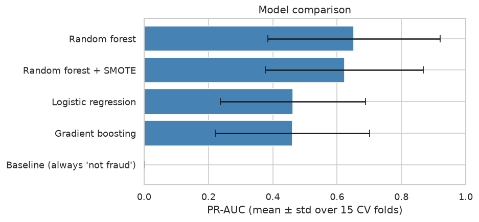
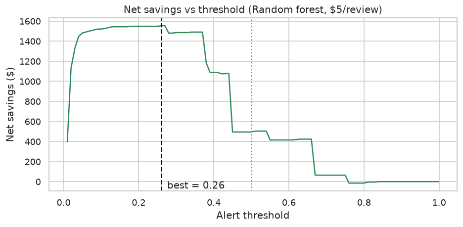
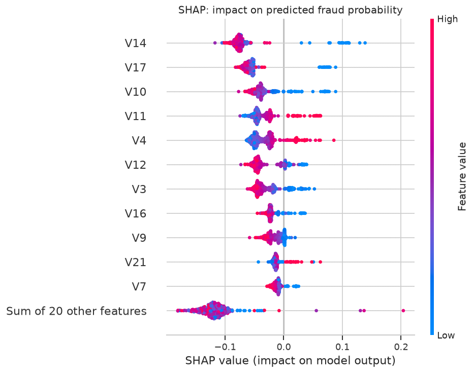

# Credit Card Fraud Detection

[](https://github.com/lukahere007/creditcard-fraud-analysis/actions/workflows/ci.yml)

[](LICENSE)

How well can we flag fraudulent card transactions when fraud is only **0.15%** of the data, and where should the alert threshold sit so that investigating alerts pays off?

This project uses the [ULB / Kaggle credit card fraud dataset](https://www.kaggle.com/datasets/mlg-ulb/creditcardfraud) and focuses on the things that usually go wrong with it: misleading metrics, data leakage, and overconfident conclusions from a handful of fraud cases.

## Highlights

| | |
|---|---|
| **Headline metric** | PR-AUC (average precision). With 99.85% legitimate rows, a model that never flags fraud is 99.85% "accurate", so accuracy is not used. |
| **Evaluation** | 5-fold stratified CV × 3 repeats, reported as mean ± std. All preprocessing (scaling, SMOTE) runs *inside* the pipeline, so nothing leaks from validation folds. |
| **Models** | No-skill baseline, logistic regression, random forest (± SMOTE), gradient boosting |
| **Decision** | Alert threshold chosen to maximise **net savings** (fraud caught − \$5 per review), not left at 0.5 |
| **Explainability** | SHAP beeswarm for the random forest |

## Results (committed 5% sample: 14,240 transactions, 21 frauds)

| Model | PR-AUC | ROC-AUC |
|---|---|---|
| **Random forest** (class-weighted) | **0.65 ± 0.27** | 0.92 ± 0.10 |
| Random forest + SMOTE | 0.62 ± 0.25 | 0.95 ± 0.10 |
| Logistic regression | 0.46 ± 0.23 | 0.83 ± 0.16 |
| Gradient boosting | 0.46 ± 0.24 | 0.86 ± 0.14 |
| Baseline (always "not fraud") | 0.001 | 0.50 |



- **Tree ensembles rank fraud best.** SMOTE added nothing over simple class weighting.
- **The threshold matters more than the model choice.** At the money-optimal threshold (0.26), the random forest catches 15 of 21 frauds and sends just 21 transactions to review. At the default 0.5 it catches only 7, which cuts net savings by about two-thirds.
- **The error bars are wide on purpose.** Some folds hold only 4 frauds. Download the full dataset (492 frauds) and rerun the notebook to get stable numbers.





## Repository layout

```
├── data/
│   └── creditcard_sample.csv   # 5% random sample (committed); put the full creditcard.csv here too
├── figures/                    # generated by the notebook
├── notebooks/
│   └── fraud_analysis.ipynb    # the full analysis, start here
├── src/fraud/                  # reusable code used by the notebook
│   ├── data.py                 # loading + feature engineering
│   ├── models.py               # candidate pipelines
│   └── evaluate.py             # repeated CV, out-of-fold scores, cost/threshold analysis
├── tests/                      # pytest unit tests
└── .github/workflows/ci.yml    # runs tests + executes the notebook on every push
```

## Run it

```bash
git clone https://github.com/lukahere007/creditcard-fraud-analysis.git
cd creditcard-fraud-analysis
python -m venv .venv && source .venv/bin/activate   # Windows: .venv\Scripts\activate
pip install -r requirements.txt

pytest                      # unit tests
jupyter lab notebooks/      # open fraud_analysis.ipynb
```

The notebook runs on the committed sample out of the box. For the full dataset, download `creditcard.csv` from Kaggle into `data/`. It is picked up automatically (and git-ignored, since it is 150 MB).

## Limitations and next steps

- **Small sample.** 21 frauds is enough to demonstrate the method, not to quote numbers. Use the full data for that.
- **Random rather than time-based split.** A production model is trained on the past and scored on the future. Next step: train on day 1, test on day 2.
- **The threshold is tuned on the same out-of-fold predictions it's scored on,** so the savings figure is optimistic.
- **`V1`–`V28` are anonymised PCA components.** SHAP shows *which* components drive predictions, not *why* in business terms.
- **`Time` is seconds since recording started,** not the clock time, so "hour" features are hour offsets.

## License

[MIT](LICENSE). Dataset by the Machine Learning Group, ULB (Open Database License).
